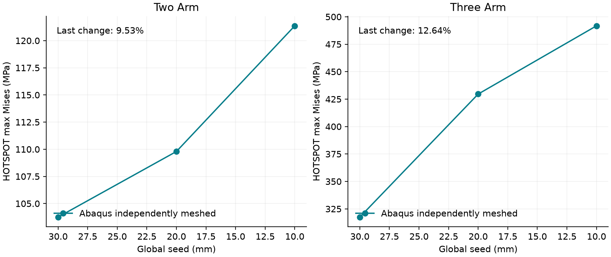
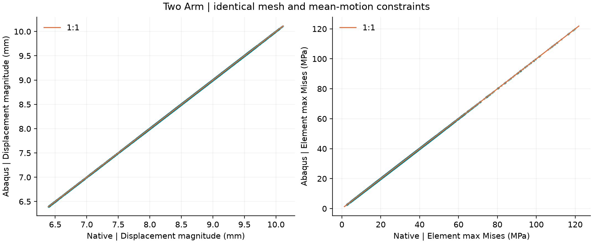
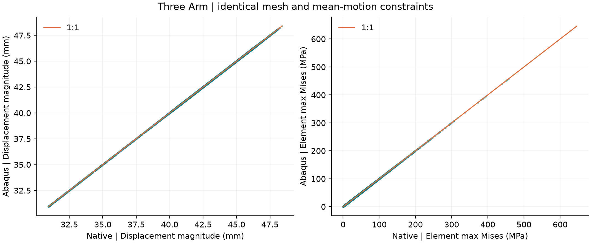

# 截图节点：历史数据恢复与 Abaqus 验证

本目录是 Git 精简记录。完整 INP/ODB/NPZ、云图和哈希清单已交付本机 桌面/新建文件夹/截图节点_Abaqus对比验证_20261020；下述原始文件说明指完整交付包。

日期：2026-10-20；单位：N–mm–MPa。

结论：两个有载荷算例在同一网格、同一切面平均运动约束下通过求解器一致性检查；截图中的应力峰值已复现。但是梁与实体之间的切面内力传递不满足原有 5% 检查，独立网格的峰值也未证明收敛，因此不能据此宣布整个梁—实体子模型链路验证通过。

## 找回的历史模型

| 截图 | 模型 | 数据来源 | 载荷与状态 |
|---|---|---|---|
| 1 | 四柱四梁，6×4×3.5 m，H300×200×8×12 mm，四柱脚固接 | 20261016_223639_eb62572f 胶囊；与图纸识别存档一致 | 原始模型没有载荷；旧实体结果为零。保留原状，不作受力精度验收 |
| 2 | 3 m 柱＋3 m 梁，H200×120×10×16 mm，柱脚固接 | 20261016_225826_060a24b7 胶囊 | 梁端向下 5 kN，LC1 |
| 3、4 | 一柱两梁，Z/X/Y 三向各 3 m，同一 H 截面 | 20261016_230634_6cfadf4e 胶囊；原始 NPZ 与 summary | 两梁端向下 5 kN、3 kN，LC1；这两张为同一算例不同视角 |

两个节点材料均为 E=206000 MPa、ν=0.3。连接分别采用历史 G2 曲率连续扫掠、柱贯通及自动 9 mm 圆角的三向过渡；它们是软件几何假设，不代表真实焊缝、螺栓或接触构造。每个短臂长 466.4761516 mm，历史热点半径 314.8714023 mm。

## 同网格、同约束的独立求解

使用存档的节点、C3D10 连接表、E/ν、外力和切面平均运动方程 C·u=g。自研用约束方程求解，Abaqus 用等价的 EQUATION 方程和辅助自由度给定位移。QR 只选取线性独立的消元主元，再作可逆行变换；没有将自研实体逐节点位移作为 Abaqus 边界。Abaqus 反力通过同一等价变换的转置还原到物理节点。应力比较先对齐剪应力分量顺序，用四积分点张量均值和各单元最大 Mises，避免积分点编号约定干扰。

| 模型 | 节点 / C3D10 | 自研峰值 MPa | Abaqus峰值 MPa | 位移相对L2 | 反力相对L2 | 应力均值相对L2 |
|---|---:|---:|---:|---:|---:|---:|
| 两臂转角节点 | 55985 / 29604 | 121.883340 | 121.883339 | 2.962e-08 | 3.898e-08 | 1.252e-08 |
| 三向汇交节点 | 69653 / 37643 | 646.335228 | 646.335205 | 2.623e-08 | 3.019e-08 | 1.331e-08 |

以上差异与 ODB 默认单精度存储的数量级相当；相对L2是差值范数除以自研参考范数。这证明所比较离散问题的求解一致性，不能替代独立的连接构造与梁—实体边界验证。

## Abaqus 节点实体化工作流：独立重新划分三档网格

直接调用生产接口 solid_joint.run_joint_analysis：整体梁先求解，切面取平均平移/转角，相同几何导出 STEP，Abaqus 原生 C3D10 网格，分布耦合传递切面运动，实际提交 Standard 并读取 ODB。全局种子为 30/20/10 mm。历史自研为全局 20 mm、局部 7.5 mm，两者不能因全局种子同为20就当作同一网格。此处 Mises 只统计节点附近 HOTSPOT 单元集；同网格表采用全模型积分点峰值，两种统计范围明确分开。

| 模型 | 种子 mm | 节点 | C3D10 | HOTSPOT最大Mises MPa | 切面合力差的最大比例 |
|---|---:|---:|---:|---:|---:|
| 两臂转角节点 | 30 | 6289 | 3135 | 103.753555 | 32.04% |
| 两臂转角节点 | 20 | 12511 | 6409 | 109.793503 | 33.45% |
| 两臂转角节点 | 10 | 75686 | 44457 | 121.360672 | 35.52% |
| 三向汇交节点 | 30 | 10045 | 4964 | 317.515076 | 112.39% |
| 三向汇交节点 | 20 | 21211 | 10811 | 429.586517 | 123.80% |
| 三向汇交节点 | 10 | 116942 | 68102 | 491.736542 | 133.91% |

三档网格只是本轮实际检查范围：峰值的变化不足以证明有限极限或奇异性。生产接口中的自动收敛诊断基于最大绝对主应力，不应误读为 Mises 的收敛结论。

## 验证范围与发现

- 截图 2 的峰值和 P99 均已复现：121.883340 MPa、76.580225 MPa。截图 3、4 对应 646.335228 MPa、209.156815 MPa；色标上限是显示分位数，并不是真实峰值。
- 两个模型的切面平均运动传递满足约束，但切面反力与整体梁内力差异超过既有5%限值。两臂原始合力差约34.96%；三向原始最大合力差约132.29%（按各切面整体梁合力的最大范数归一）。Abaqus原生工作流也须以表中数值审查，不能把同网格一致误写为整体链路全部正确。
- 连接是线弹性连续体，没有材料屈服、真实焊缝、螺栓或接触。646 MPa 仅为当前弹性模型结果；模型只给E和ν，没有屈服参数，不能据此作强度或承载力判断。
- 同网格作业保留输入网格质量提示：三向原网格有14个畸变质量警告单元；辅助自由度2/3未激活的边界被忽略，不影响用于约束的自由度1。没有隐藏这些日志。
- 能量检查使用真实 ODB 的 ALLSE/ALLWK；本轮线性静力没有人工稳定能，ALLAE为0。原始数据与检查结果在 comparison_summary.json。
- 下一步应先核对实际连接和整体梁截面假设，再做短臂长度、位移/内力加载方式对照及局部网格加密。框架还需要原题载荷。

## 文件与复核

每个算例目录包含 model.json、provenance.json、boundary_spec.json、native、abaqus、same_mesh。same_mesh 内有原始 INP/ODB/STA/MSG/DAT、逐节点位移/反力与逐单元应力对 paired.npz。Abaqus 工作流三档输入与输出在 abaqus/node_2_LC1。所有求解状态均核对 COMPLETED SUCCESSFULLY。输入文件哈希见 manifest.json。未修改生产求解器、界面或测试；未执行全量回归。

