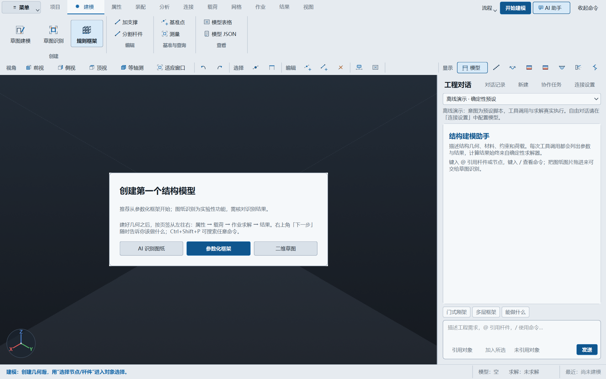
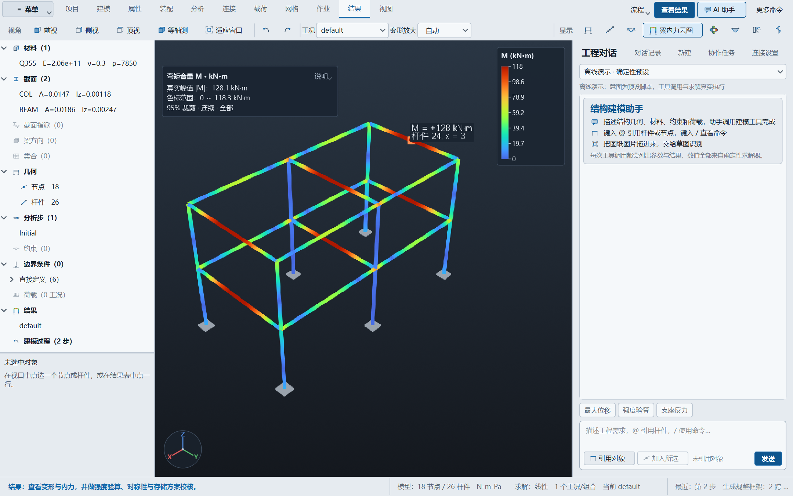
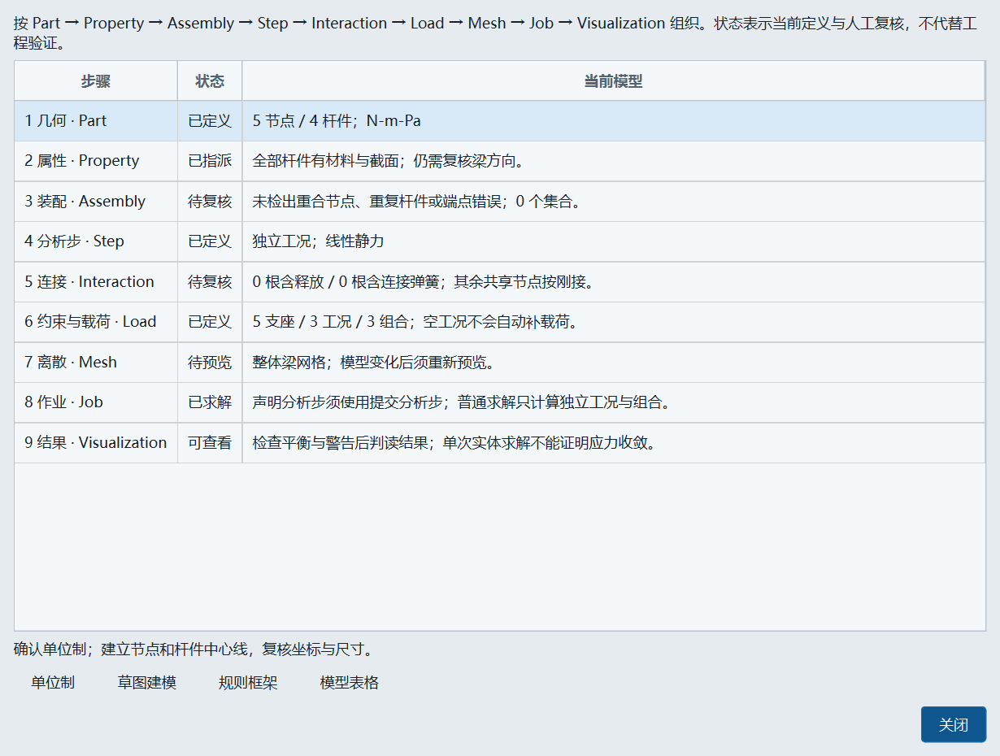
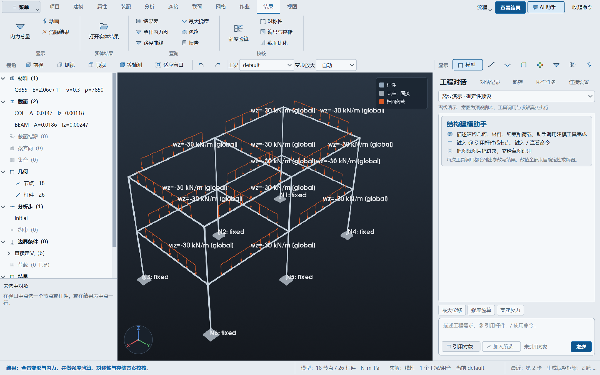
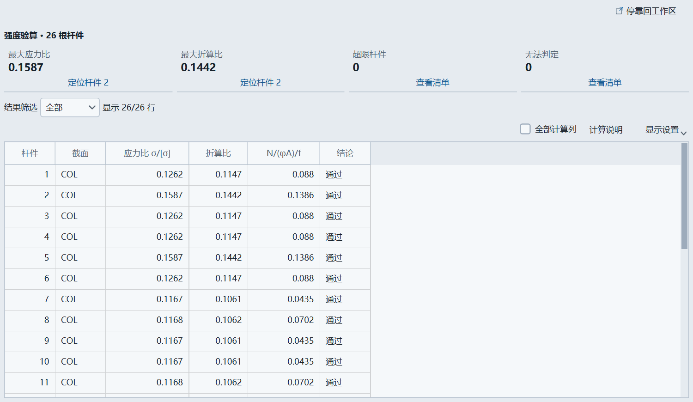
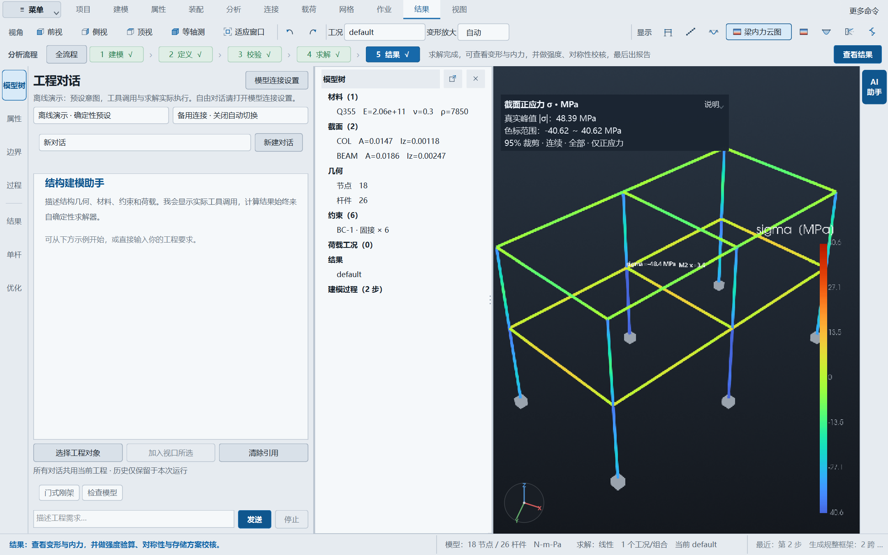
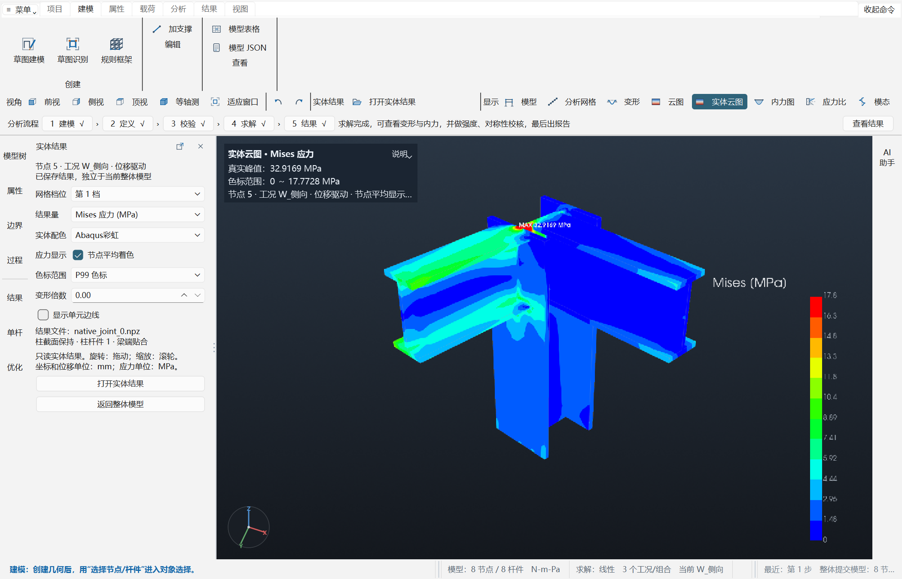
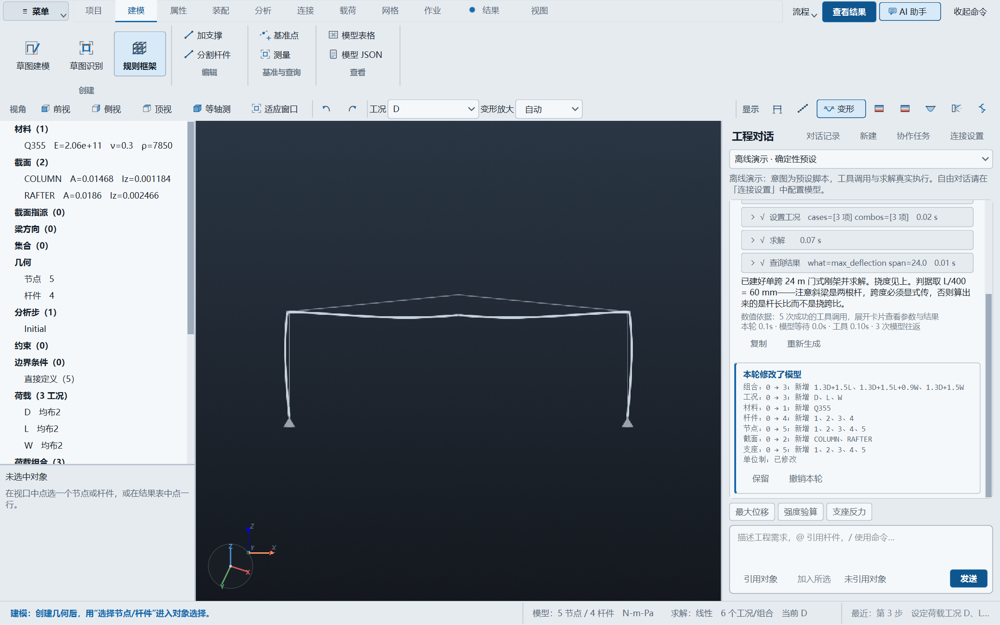
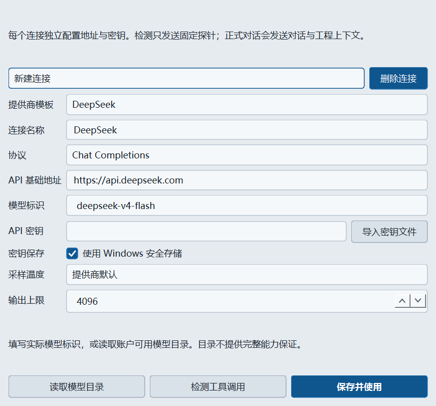

# 使用手册

**这本手册不假设你学过结构力学，也不假设你会写程序。**
从"这软件是干什么的"开始，每一步都写清楚**点哪里、会看到什么、下一步做什么**。

如果你只想尽快看到东西动起来，直接翻到 **第 2 章 五分钟上手**。

> 学过材料力学、结构力学的话，读 **《大学生教程》（`docs/大学生教程.md`）**
> 更合适：那本讲得深一层——每个功能背后在算什么、什么时候该用、
> 什么时候它会拒绝你，还有完整的能力边界和快捷键表。

---

## 1 这个软件是干什么的

想象你用积木搭一个架子：几根竖着的柱子，上面横着几根梁。搭好之后你想知道：

- 站上去会不会塌？
- 哪根最吃力？
- 会弯到什么程度？

这个软件就是回答这三个问题的。你告诉它**架子长什么样**、**哪里被固定住**、
**上面压了多重**，它算出**每根杆受多大力、弯了多少**，并且告诉你**够不够结实**。

它还有一个别的软件没有的地方：**你可以直接用中文跟它说话。**
比如打一句"两跨三层，跨度 6 米，层高 3.6 米，梁上均布 20 kN/m"，
它自己就把架子搭好、荷载加好、算好。

### 几个词，用生活语言解释

| 专业词 | 就是指 | 在软件里长什么样 |
|---|---|---|
| **节点** | 杆子和杆子接头的地方 | 一个小点 |
| **杆件** | 一根柱子或一根梁 | 一根管子 |
| **约束（支座）** | 被钉死、不能动的地方 | 柱脚下面的小方块或三角 |
| **荷载** | 压在上面的重量 | 一排绿色小箭头 |
| **工况** | 一种受力情况 | 比如"自重"是一种，"刮风"是另一种 |
| **内力** | 杆子内部承受的力 | 云图上的颜色 |
| **位移 / 变形** | 被压得移动了多少 | 变形图里歪掉的样子 |
| **弯矩 M** | 把杆子掰弯的那种力 | 通常最关键的一个数 |
| **轴力 N** | 顺着杆子方向拉或压的力 | 正数是拉，负数是压 |

---

## 2 五分钟上手

### 第 1 步：把软件跑起来

有两种拿到这个软件的方式，**看你手上是哪一种**：

| 你手上是 | 怎么打开 | 要装 Python 吗 |
|---|---|---|
| 一个叫 `FrameLab` 的文件夹 | 双击里面的 `FrameLab.exe` | **不用** |
| 项目源码文件夹 | 双击 `run_desktop.bat` | 要，第一次会自己装 |

拿到 `FrameLab` 文件夹的话，**整个文件夹都要留着**，单把 `FrameLab.exe`
拖出来是跑不起来的。首次启动 3~5 秒。

跑源码那种，第一次打开会自己装东西，要等几分钟，屏幕上会刷一堆字——
**这是正常的**，别关。装完会出现下面这个窗口：



> **打不开怎么办？** 别急着猜。
>
> 跑源码的：双击 `run.bat`，或者在命令行里敲
> `python -m desktop.app --doctor`，它会逐项检查并用中文告诉你**哪一项坏了、
> 下一步做什么**。实在不行，`run_gui.bat` 是网页版，功能一样全。
>
> 用 `FrameLab.exe` 的：双击没反应多半是杀软拦了没签名的程序，
> 在杀软里把整个文件夹放行；提示缺 `VCRUNTIME140.dll` 就装一下微软官方的
> VC++ 运行库（x64）。

### 第 2 步：搭一个架子

屏幕中间那张卡片给了三条路，**新手请点最中间的「参数化框架」**：

| 按钮 | 什么时候用 |
|---|---|
| AI 识别图纸 | 你有一张手画的草图，想让它自己看懂 |
| **参数化框架** | **你只想快速搭一个规规矩矩的架子（推荐从这里开始）** |
| 二维草图 | 你想自己一根一根画 |

首屏推荐参数化框架；AI 识别图纸属于实验性功能，识别后需核对再加载。

点「参数化框架」，弹出「参数化建模」窗口。最上面选**结构形式**
（规整框架 / 坡屋面门式刚架 / 不规则折线刚架），新手选默认的「规整框架」。

下面三行填的是**一串数，不是个数**——这一点最容易填错：

| 填什么 | 举例 | 意思 |
|---|---|---|
| 各跨跨度 (m) | `6 6` | 横向两格，每格 6 米 |
| 各层层高 (m) | `3.6 3.6 3.6` | 三层，每层 3.6 米 |
| 各开间宽度 (m) | 留空 | 只做一榀平面框架；填 `5` 就沿进深再拉一个 5 米的开间 |

也就是说，**写几个数就是几跨、几层**。

填完点「确定」，屏幕中间就出现一个三维的架子。**可以用鼠标拖着转。**

> 窗口下面还有一个勾选项「生成时同时指派属性、柱脚与荷载」。
> **默认不勾**，因为正规流程是几何、属性、荷载分开做（和 Abaqus 一样）。
> 勾上可以一步到位，但下拉框里**只能选已经定义好的材料和截面**——
> 所以想用这个快捷方式，得先按 3.2 节把材料和截面建出来。

### 第 3 步：让它算

看顶上那一条 **`1 建模 → 2 定义 → 3 校验 → 4 求解 → 5 结果`**，
这是摘要流程；人工建模各环节请按3.0节的九阶段检查清单完成。

点 **「4 求解」**（或者直接按键盘 **F5**）。等一两秒，几步都会打上勾。

### 第 4 步：看结果

求解完，架子会变成彩色的——**颜色就是受力大小**。



右边那根彩色的条叫**色标**，是颜色和数字的对照表：
**蓝的一头最小，往上经过青、绿、黄、橙，红的一头最大。** 默认是沿杆
**平滑渐变**，一眼看出力沿着杆子怎么变——梁端和跨中红、反弯点附近变蓝。
想把杆子上的一段**对到色标上一个数字区间**，把「分级」从「连续」改成
12 级之类，云图就变成一格一格的色块。

视口左上角的摘要显示当前分量、**真实峰值**、**色标范围**和裁剪/筛选状态。
真实峰值取完整结果的最大绝对值；仅正值或仅负值筛选只影响着色。
95% 裁剪会让超出量程的颜色饱和，因此读取最大值应看真实峰值或极值标注。
点击摘要中的 **说明** 查看正负号定义和适用限制；σ 是梁截面正应力，不包含剪切与扭转剪应力，也不能替代完整承载力验算。

顶上还有几个常用视角：

- **「变形」**：看它被压得歪成什么样（会放大，否则肉眼看不出来）
- **「云图」**：看每根杆受力大小
- **「内力图」**：像结构力学课本那样，在每根杆旁边画出弯矩图、剪力图、
  轴力图——**高度就是数值**，弯矩画在受拉侧。剪力、轴力沿杆不变时，
  云图上整根杆一个颜色看不出大小，这里画出来是矩形，高矮一眼可比
- **「应力比」**：回答"够不够"——每根杆按强度、折算应力、稳定三者里最不利
  的那个着色，蓝（<0.5）→ 绿 → 黄 → 橙（0.9–1.0）→ **红（>1.0，不合格）**；
  灰色表示这根杆的稳定判不了（粗短柱上欧拉公式不适用）。材料要先给许用应力
- 想换看别的力（轴力、剪力、应力），点功能区「结果 → 内力分量」

云图长什么样，在「结果」小窗上有四个开关，**都只改显示、不改算出来的数**：

| 开关 | 干什么 | 什么时候动它 |
|---|---|---|
| 「色系」 | 彩虹 / 蓝—灰—红 / 单蓝 | 要黑白打印，或有人分不清红绿，换成后两种 |
| 「分级」 | 色块分几格 | 看不出梯度就调多，眼花就调少 |
| 「立体」 | 给云图打一层柔和的光 | 想严格照色标读数就关掉，关掉是纯平涂 |
| 「云图量程」 | 95% 裁剪 / 满量程 | 有一两根杆特别大、把其余全压成一个色时，用裁剪 |

---

## 3 完整流程：一个真正能交差的算例

五分钟上手跳过了几步。下面是一次完整的分析该怎么走。

### 3.0 按CAE九阶段完成人工建模（2026-10-14）

顶部模块按几何、属性、装配、分析步、连接、载荷、网格、作业、结果排列。
点击分析流程条的「全流程」或建模页的「刚架建模全流程」，打开检查清单；
选中某一步，下面的按钮会打开实际编辑器。窗口可以保持打开，编辑后返回继续复核。

这套顺序参照[Abaqus官方建模教程](https://docs.software.vt.edu/abaqusv2025/English/SIMACAEGSARefMap/simagsa-c-caebeamsummary.htm)。
当前软件采用全局坐标下的梁杆系，装配阶段核对拓扑与区域；没有照搬独立CAD部件实例、
实体接触和螺栓预紧。整体梁离散与局部实体网格分别定义，不能把梁中心线云图当成实体应力。

| 阶段 | 实际操作 | 进入下一阶段前核对 |
|---|---|---|
| 1 几何 / Part | 先确认单位制；用草图、规则框架或坐标建点建立中心线与杆件 | 尺寸、工作平面、节点位置和杆件端点；参数化几何默认不补材料或载荷 |
| 2 属性 / Property | 创建材料及截面；用「批量属性指派」及「梁截面方向」完成属性设置 | 所有杆件都有属性，强弱轴正确；参考向量不得与杆轴平行 |
| 3 装配 / Assembly | 执行「装配检查」，用「命名集合」保存节点或杆件组 | 同坐标不同编号、重复杆件、缺失端点须修正；相交中心线不自动粘结，集合也不创建连接 |
| 4 分析步 / Step | 独立线性工况使用求解设置；需要改变载荷或约束时用分析步管理器及幅值 | Initial是初始约束；独立工况与声明步骤的实际生效载荷不同；位移、反力及杆端力固定输出 |
| 5 连接 / Interaction | 用「杆端连接」按i端、j端或两端，分别设置rx、ry、rz为刚接、释放或转动弹簧 | 保持原值不会改动该方向；释放rz只对应局部z方向；弹簧刚度要有依据，不能根据螺栓数量自动认定刚接 |
| 6 约束载荷 / Load | 定义支座、节点力、杆件荷载、重力及组合；查看约束和载荷管理器 | 单位、方向、作用对象与有效工况正确；自重需要密度，空工况不会自动补荷载 |
| 7 离散 / Mesh | 用「预览梁网格」检查分析杆段与物理杆件映射 | 内节点、杆间集中力及力矩位置自动剖分；当前不能在此指定Abaqus梁类型或任意梁种子尺寸 |
| 8 作业 / Job | 先「完整性校验」，再「机构诊断」；独立工况点求解，声明步骤点「提交分析步」 | 定义完整不等于结构稳定；后台运行状态在状态栏显示，可停止；分步求解保留最后一步用于后处理 |
| 9 结果 / Visualization | 查看变形、反力、内力和警告，再做局部实体分析或导出报告 | 平衡及模型假设需复核；局部实体另外设置C3D10网格，单档网格不能证明热点应力收敛 |

清单的已定义、已指派、已预览只表示对应数据存在，不表示结果已验证。
装配和连接需点击「确认本步骤已复核」记录人工确认；模型发生变化后，确认及网格预览自动失效。
批量局部轴和连接改动先检查整组，有一根杆件不合法就全部拒绝；成功操作只形成一个撤销步骤。

模型表格允许尚未指派材料、截面或尚未定义支座的几何草稿；已有数值、端点引用和连接设置仍需合法，错误改动不会覆盖原模型。草稿写回不代表可以求解，作业提交前仍需完整性校验。

声明步骤目前各自从未变形、无应力状态重解，支持载荷及约束配置传播，不继承塑性历史，
也不支持杆件在步骤间生灭。当前流程没有增加接触、螺栓预紧或通用大变形求解能力。



### 3.1 建模（顶上第 1 步）

同第 2 章。建完之后，**左边的「模型树」会列出你建了什么**：材料几种、截面几种、
多少节点、多少杆件、几个支座、几个工况。**这棵树是你的检查清单**——
数字对不上，说明哪一步漏了。

在视口或模型树中选中杆件后，左侧 **属性** 先显示端点、长度、截面和材料。
展开 **高级参数** 可编辑梁方向、刚域偏移、计算长度系数与端部约束；节点属性直接显示坐标和支座约束。
输入完成后按回车或移开焦点提交。非法输入会恢复原值，并在对应字段旁显示原因和修改建议；窄屏会滚动到该提示。
成功修改会使原有分析结果失效，需要重新求解；可用撤销恢复修改。

### 3.2 定义材料和截面（第 2 步）

点功能区 **「属性」** 页。这一页从左到右就是"先有材料、再有截面、然后指派给杆件"。

**材料**（钢、混凝土之类）点「创建材料」。要填的：

| 填什么 | 钢材常用值 | 什么时候必须填 |
|---|---|---|
| 弹性模量 E | 206000000000 Pa（2.06e11） | 总是 |
| 泊松比 ν | 0.3 | 总是 |
| 密度 ρ | 7850 kg/m³ | 想让它算自重时 |
| 屈服应力 | 355000000 Pa（Q355） | 想做稳定校核时 |
| **许用拉应力** | 215000000 Pa | **想做强度验算时** |
| 线膨胀系数 α | 0.000012 | 想算温度应力时 |

> 后面三项在「强度验算与温度（可选）」那一组里，**默认不填也能算位移和内力**，
> 只是做不了强度验算。不填就不填，软件会明确告诉你缺什么，
> **不会偷偷拿个默认值糊弄你**。

**截面**（杆子多粗）点「创建截面」。选一个形状（工字钢、圆管、矩形……），
填几个尺寸，**截面特性它自己算**，还会在下面告诉你这个截面能不能做强度验算。

### 3.3 加约束和荷载（第 3 步）

功能区 **「载荷」** 页。

- **「创建边界条件」**＝指定哪里被固定死。柱脚一般选「固接」（完全不能动）
  或「铰接」（不能移动但能转）。
- **「创建载荷」**＝压多重。梁上的均布荷载最常见，比如 `20 kN/m`。
- **「重力」**＝自重。它按材料密度和截面面积自动算，**前提是你填了密度**。

> **单位提醒**：软件默认用**牛顿和米**。你说"20 kN/m"，要填 `20000`。
> 跟 AI 对话时可以直接说 kN，它会帮你换算并把换算过程写出来。

### 3.4 校验与求解（第 3、4 步）

点 **「3 校验」**。它会检查：有没有杆子悬空、有没有地方没固定、材料截面有没有漏指派。
**有问题会用中文列出来，指明是哪个节点、哪个方向。**

校验过了点 **「4 求解」**（F5）。

后台求解、识别或截面优化执行期间，模型编辑入口会暂时禁用，视角仍可旋转和缩放。
长任务可点击状态栏的 **停止任务**；系统在增量、参数样本或网格阶段之间安全停止，
矩阵分解完成前需要等待。关闭窗口也会先请求停止，任务结束后再退出。
状态栏显示当前分析类型，鼠标停在求解状态上可查看本次求解编号、模型指纹和参数。

> **如果报"结构成为机构"**：意思是这个架子没被固定住，会整体飘走或转动。
> 在作业页点机构诊断，它会告诉你**是哪些节点的哪些方向缺约束**。

### 3.5 看结果与校核（第 5 步）

顶部默认展开完整模块功能区，下方保留常驻工具栏与分析流程。
选中 **「结果」** 页即可直接验算或导出报告；点击右上角的 **收起命令** 或双击页签可收起内容，
再点 **更多命令** 展开。视角、选择、编辑与显示模式有直接按钮；窄屏会缩短按钮显示，
当前模式保留文字，鼠标停留半秒可查看完整名称、快捷键与用途。
开始手工建模后，建模设置按钮提供工作平面、捕捉和精确坐标。

结果表、单杆内力图与截面优化默认使用可移动、可缩放的非模态独立窗口，打开后不会占用底部抽屉，
也不会触发模型缩小或移动。结果窗口关闭后可从左侧原入口重新打开，表格内容、排序和选择保留。
小屏幕高缩放时，首次弹窗限制在可用屏幕宽度的80%、高度的75%以内，可滚动阅读或手动放大。
模型树、属性等面板的标题栏右侧有独立窗口图标。移出后可并排查看模型与表格，
窗口中的停靠回工作区按钮可返回原位；未提交输入、表格内容和选择状态会保留。
关闭独立窗口后仍可从原侧栏入口重开。需要固定布局时可手动停靠回底部；本次使用期间尊重该选择。
独立窗口按Esc关闭，主窗口退出后各面板同时隐藏；求解完成仍不自动弹出结果表。
拖动面板内侧边缘可调尺寸，双击边缘恢复默认；Tab 可定位侧栏入口，空格可开关。

展开后的结果页提供以下操作：



| 按钮 | 回答什么问题 |
|---|---|
| 内力分量 | 换一个力来看（轴力/剪力/弯矩/**应力**） |
| 单杆内力图 | 沿着一根杆子画一条曲线，看峰值在哪 |
| 最大挠度 | 最不利的那根杆弯了多少 |
| 包络 | 多个工况里，每个位置最不利的是哪一个 |
| **强度验算** | **够不够结实** |
| 对称性 | 结构对称吗？顺便自我检查算得对不对 |
| 编号与存储 | 课程里讲的带宽与存储方案对比 |
| 报告 | **一键出 Word 计算书** |

点 **「强度验算」**，下面会出来一张表，**一行一根杆**：

表格上方先显示最大应力比、最大折算比、超限杆件数与无法判定数。
摘要采用紧凑文字排列，点击定位或清单入口可定位杆件或筛选结果。
默认只显示六个关键列，剪切折算比与规范稳定比始终保留；勾选 **全部计算列** 查看长细比、φ、类别和 μ 来源等诊断列。
完整结论和适用限制保存在 **计算说明** 中，云图量程、色系等参数由 **显示设置** 打开。
计算失败或结果失效时，原因和下一步会直接展开显示。

表格的 **结果筛选** 可切换全部、超限或无法判定；排序后仍可点击行定位对应杆件。
支座与荷载标签会自动避让，选中对象的标签优先显示，箭头和约束符号保持可见。



怎么读这张表：

- **应力比 σ/[σ]**：小于 1 就是够结实。0.76 表示用掉了 76% 的余量。
- **折算比**：另一条独立的结论，**也要看**。它把拉压应力和剪应力合起来判，
  而上面那个只看拉压。一根又短又粗的梁，上面那栏可能显示 0.06 看着很安全，
  折算比却是它的两三倍——差别在剪力上，只看第一栏是看不见的。
  **两栏都小于 1 才算过。**
- **控制点**：折算比最不利的位置在哪儿。"中性轴"意味着这根杆是被剪力控制的。
- **N/Pcr 和 N/(φA)/f**：两个稳定指标并排放着，**以右边那个为准**。
  左边是教科书的欧拉公式，它只在细长杆上可信；右边按规范算，粗短杆也算得了。
  两者差很多是正常的——正因为会差很多，才要把它们摆在一起。
- **φ 和类别**：规范用的稳定系数，以及按哪条曲线取的（a/b/c/d）。
  类别不同 φ 能差一半，所以这一栏写出来让你知道这个数的来历。
- **结论那一列有三种，不是两种**：
  - **通过** —— 没问题
  - **超限** —— 真的不够，行会标**红**
  - **判不了** —— 行标**琥珀色**。现在很少见了：只有材料没填屈服应力时
    才会出现，因为那时候连规范的方法也算不了。
    这不是软件坏了，是它在诚实地说"缺参数，这个问题回答不了"。

  > 完整的结论（比如"稳定按 GB 50017 b 类，φ=0.954"）在表格**上方的说明里**，
  > 格子里只放两个字，否则会被截断。

> 这一点值得记住：**这个软件宁可说"我判不了"，也不给你一个来路不明的数。**
> 缺许用应力就拒绝做强度验算，截面缺尺寸就拒绝画应力云图——
> 都会明确告诉你缺什么、去哪儿补。

材料填了许用应力、截面又是按尺寸建的，就能把云图切到 **σ**，
直接看每根杆上的正应力分布：



红的地方应力高，蓝的地方低。右边色标上那条刻度就是数值对照。
看到某根杆整根发红，再回头去看强度验算表里它那一行，两处应该对得上。

### 3.6 查看节点实体云图

2026-10-13 修复加载节点：切面位移驱动同时重建实体保留区的集中力、力矩和线荷载。
使用已编译工况和组合系数，集中力剖分成节点荷载后只计一次；分布荷载按保留长度裁切，
线性强度逐段解析积分，保留合力及关于节点原点的合矩。
加载区采用实体外表面的正面积权重，通过六分量对偶算子施加静力等效节点力；驱动切面不参与加载区。
加载区范围与截面尺度有关，属于缺少真实加载头时的施力假设，区内峰值不能解释为真实接触或焊缝应力。
自研与Abaqus共用同一表面积分配算法，结果保存原载荷来源、加载区及实际施加合力与合矩。
切面反力对照改为整体梁真实切面内力，包含保留段分布荷载的影响；内部支承、温度或初应变未重建时仍拒绝。
云图按二次单元中点提取曲面，以连续应力张量平均着色，保留截面锐边并增加轮廓线；不改变原始网格和峰值。
显示曲面单元号映回原体单元；色标明确绑定应力图层，防止轮廓图层改变色谱或单位范围。
实体配色默认采用Abaqus Rainbow十二级离散彩虹谱，低值蓝、经青绿黄到高值红；桌面、自研图片和Abaqus导出一致，仍可选择柔和蓝红、蓝绿黄或蓝黄。

教学示例 `examples/空间刚架_简单整体复杂实体.json` 可直接打开：4m×3m平面、3m层高，
8个节点、4柱4梁，柱脚固接；H200×200×12×16柱与H200×100×10×14梁保留真实轮廓。
G工况四个柱顶各向下10kN，柱脚各反力10kN，柱顶Uz=-0.0173040717634464mm与-P·L/(EA)一致；
W工况用于空间侧移，节点5的一体连续版已完成19244个C3D10试算，实际局部过渡半径9mm。
原材料与远端截面保持；单档网格和切面反力差异不作为局部应力收敛结论。


2026-10-14 一体连续节点：用户明确选择一体成形实体假设，无焊缝、螺栓或接触界面。
柱顶模板先保留完整柱截面并按真实材料面定位梁端，再使用OpenCASCADE滚动球算法生成交汇处曲面。
请求半径取最小截面特征厚度的0.9倍，内核不接受时尝试半径减半；这属于几何模板参数，不是规范设计尺寸。
通过CAD实体差集验证原材料未被削减、新增材料全部位于半径为最短臂长度0.6倍的局部球域内；
校验不通过则拒绝候选过渡，两个候选都失败时说明原因，不把尖角实体标成曲面过渡。
保留驱动切面原轮廓与面积，结果记录实际半径、材料损失量、过渡域外增材量与容差。
当前明确验证的是三向H型柱顶模板；匹配两臂继续采用G2扫掠，其他拓扑按实际算法记录核对。
一体连续实体与实际钢结构装配节点的局部应力、刚度不同，几何光顺不作为强度或刚度验算结论。

2026-10-13 修复柱顶连接：唯一竖向柱与水平梁相接时，自动方式优先保持完整柱截面。
梁端根据柱真实轮廓与轴线的交点接到翼缘或腹板，逐段检查梁宽投影是否完整落在柱材料范围，
孔洞、过宽梁或不能贴合的斜面明确拒绝，不用角平分面削切柱翼缘或向后延拓梁填入柱空隙。
柱顶延长至梁外缘，保存柱杆件号、延长量及各梁起点；这是明确的柱顶尺寸与理想粘结假设，
未建立焊缝、连接板或接触。其他节点仍按已记录的扫掠或斜接方式处理，显式斜接选项保留。

2026-10-13 更新节点连接算法：匹配的两臂截面优先采用五次Bézier曲线扫掠。
前三与后三控制点分别沿直杆方向共线且等距，端点曲率为零；优化控制点比例以降低最大曲率，
并将最小中心线曲率半径限制在截面包围半径的1.3倍以上。由真实轮廓生成CAD扫掠实体，
腹板、翼缘、管壁和孔洞随曲线连续过渡，远端切面尺寸与朝向保留。
多臂、截面不一致或朝向不匹配时，沿角平分半空间延拓与裁切杆件及空腔，再并为连续实体，
按局部材料占比识别凹边并生成滚动球圆角；圆角失败明确记录，保留有效斜接，不自动改回凸包。
节点几何提供一体连续节点（自动）、斜接裁切与圆角、截面包络填充（原方式）、原始杆件交汇。
结果保存实际算法、控制点、过渡长度、最小中心线半径或实际圆角状态，实体面板同步显示。
支持八类参数截面和带孔多边形，旧模型只有A/I/J而无真实尺寸时仍须补充轮廓。
G2扫掠改变节点中心线形状，斜接和圆角也代表几何假设；一体连续实体与实际焊接节点应分别解释，
应按实际图纸校核。当前仍限同材料、无刚域偏移和线性静力整体解，未定义真实焊缝、螺栓或接触。
网格可指定尺寸并局部加密，圆角区域按实际半径细化；云图张量平均仅用于显示，原始峰值保留。
自动过渡尚无IIW焊趾路径，暂不给正式Kt；几何光顺不代表强度优化完成，切面反力差异仍需校核。


整体梁模型求解后，在 **作业** 页选择节点并执行 **节点实体**。分析完成后自动进入
**「实体云图」** 主视口，可拖动旋转、滚轮缩放，沿用前视、侧视、顶视、等轴测和适应窗口。

默认采用整体—局部位移驱动：从整体梁解恢复实际切面处的平移和转角，分布耦合只控制切面
的平均运动，允许截面局部变形。自研后端使用正的表面积权重，Abaqus 6.14 后端通过切面
参考点分布耦合施加同一组运动；位移模式不固定锚固臂。结果摘要保存加载方式、切面运动、
整体求解标识、运动误差及切面合力/合矩，便于追溯。
实体切面反力与整体梁内力差异超过 5% 时会提示检查剪切变形、平均刚度和短臂长度。

当前位移驱动要求线性静力整体解；保留区集中力、力矩和线荷载自动重建为静力等效加载区。
温度场、初应变和内部支承未重建时仍拒绝分析。
加载区内峰值依赖施力假设，应按真实加载头、接触或加载面核对。原六分量内力方式保留为对照。几何要求同材料、无刚域偏移；支持范围和截面尺寸要求见下文；应检查整体与实体
刚度一致性，并改变短臂长度检查切面边界影响。

已经计算过的结果，无需再次求解：在 **结果** 页点击 **「打开实体结果」**，选择结果目录中的
**summary.json**、`.vtu` 或 `.npz`。左侧 **「实体结果」** 面板提供网格档位、结果量、色标范围、
变形倍数和显示单元边线；隐藏面板后，再点实体云图入口即可重新展开。

| 设置 | 含义 |
|---|---|
| Mises 应力 / 最大绝对主应力 | 原单元应力单位 MPa；节点平均着色可选，仅改变显示 |
| 位移幅值 | 节点位移向量的长度，单位 mm |
| P99 色标 / 完整范围 | P99 仅截断颜色范围，左上角始终显示全部结果中的真实峰值 |
| 变形倍数 | 0 为原始几何，1 为真实变形；放大显示不会修改原始网格或计算结果 |

点击 **「返回整体模型」** 可回到杆件视图。当前分析产生的实体结果绑定整体求解版本，
模型或求解发生变化后失效；从文件打开的结果明确标注为已保存结果，独立于当前整体模型。
单档网格可查看应力分布，正式应力集中系数仍需满足多档收敛条件。



### 3.7 出报告

点 **「报告」**，它会生成 Markdown 和 Word 两份计算书，
包含模型概况、校验、位移、反力、内力极值、自振、稳定、强度验算、对称性、
存储方案对比，还有变形图和内力图。

**报告里每个数字都来自刚才那次计算**，不是另外算的。

导出复用当前分析结果，保留线性、P-Δ 或材料非线性分析类型；报告携带求解编号、
模型指纹与分析参数。模型修改后，旧结果表、探针、内力曲线和云图一并失效，需要重新求解。
正式保存与自动保存都先写完整临时文件再替换；保存失败会说明原因并提示检查权限或另选目录。

### 3.8 两个让画面清爽的小开关

**荷载数值。** 一显示载荷就满屏都是数字，遮住的正是它们要说明的那根杆件。
点功能区「视图 → 荷载数值」可以关掉——**箭头还在**，方向和分布照样看得见，
只是不再标数。再点一次就回来。

**中英文界面。** 点「视图 → 中 / EN」在中英文之间切换。
翻的是功能区、菜单、流程条、结果面板这些**界面骨架**；
对话框正文和报错信息仍然是中文，切过去之后会看到这一点，这里先说清楚。

---

## 4 用中文跟它说话（AI 助手）

AI 助手默认与三维模型并排显示，可拖动中间分隔线调整比例。右侧 AI 按钮或 Ctrl+G
切换显隐，收起后恢复完整模型视口；偏好设置保留显隐与比例。**它能做什么**：

- 听懂"两跨三层，跨度 6 米，层高 3.6 米"这种话，自己把架子搭出来
- 你没说清楚的地方**会反问你**（比如没说截面多大）
- 算完之后解释结果、告诉你哪里最危险

**它不做什么**：

- **它不做任何计算。** 所有数字都来自求解器，它只负责把你的话变成操作、
  再把结果讲给你听。这是故意设计成这样的——让它算数，它算错了也不会告诉你。

> **要联网和密钥**。没有密钥时它处于"离线演示模式"：对话按预设走，
> 但**工具调用和求解都是真的在执行**。自由对话请在应用内模型连接设置中配置密钥，
> 不要将密钥粘贴到聊天框或终端。

---

### 4.1 模型连接与对象上下文

点击「模型连接设置」，选择 DeepSeek、OpenAI、Anthropic 或自定义模板，填写 API 基础地址与实际模型标识。
密钥可以直接粘贴到密码框，或通过「导入密钥文件」读取 UTF-8 单行文本。
Windows 勾选安全存储时使用当前用户加密保存；不勾选时密钥仅本次运行有效，下次打开须重新填写。
原有环境变量与程序目录下的 deepseek.key 仍可使用。

「读取模型目录」只检查目录连接；随后「检测工具调用」发送一次固定探针，可能计入提供商用量，
不上传工程模型或历史，不调用求解器。检测成功后通过「保存并使用」启用连接。
正式对话会将近期对话与工程工具上下文发送给所选提供商。
支持 Chat Completions 兼容协议与原生 Anthropic Messages；采样温度可用提供商默认，输出上限可单独设置。
这里只提供文本工程工具，对视觉、知识检索与模型全部能力不作目录推断。

模型下拉框切换连接时保留当前对话、工具配对历史和工程模型。备用下拉框按需选择本次运行的备用连接；
各连接使用各自的密钥，失败切换会显示实际模型。运行中锁定连接、会话和对象选择。
对话选择框可切换本次运行的历史，通过「新建对话」另开对话；小窗口用会话按钮打开菜单。
所有对话共用当前工程，关闭程序后聊天历史不保留；打开另一工程会清除旧工程对话与对象引用。

「选择工程对象」打开可搜索的节点与杆件多选窗口，双击可定位到三维模型；也可在视口选中对象后点击「加入视口所选」。
每轮最多引用50项，显式加入后才发送对象数据；模型修改会使引用过期，须重新选择或清除引用。
引用不会修改用户输入的确认文字，工程变更仍沿用原有预演与确认约束。





---

## 5 出问题了怎么办

**先看这张表，不要瞎点。**

| 现象 | 多半是什么原因 | 怎么办 |
|---|---|---|
| 双击 `.bat` 一闪就没了 | 依赖没装好 / 显卡驱动 | 命令行跑 `python -m desktop.app --doctor`，看哪一项是 `!!` |
| 打开是黑屏或者一开就崩 | 没有可用的 OpenGL（远程桌面、虚拟机常见） | 用网页版 `run_gui.bat`，功能一样全 |
| 求解报"结构成为机构" | 约束不够，架子会飘 | 「分析 → 模型检查」，它会指出是哪些节点哪些方向 |
| 点「强度验算」被拒绝 | 材料没填许用应力 | 「属性 → 创建材料」勾上"给出许用应力" |
| 点「应力云图」被拒绝 | 截面没有极端纤维距离 | 用「创建截面」按尺寸建的截面才有；直接填 A/I/J 的没有 |
| 云图一片同色 | 有个别位置数值特别大，把别处压扁了 | 结果面板把「云图量程」从"满量程"切到"95% 裁剪" |
| 结果看着不对劲 | 先用对称性自查 | 点「对称性」，结构对称的话它会验证结果是不是也对称 |
| 改了模型，结果没变 | 结果还是上一次的 | 重新点「4 求解」。改模型会自动清掉旧结果 |

> **一条总原则**：这个软件里，**大多数"不对"都会明确告诉你原因**。
> 看到红字先读完再动手，它写的是"哪里错了 + 下一步做什么"，不是错误代码。

---

## 6 不用界面，用命令行

想批量算、或者接到别的流程里：

```bat
cd /d <项目文件夹>
.venv\Scripts\activate.bat
set PYTHONPATH=src;evalset;abaqus_bench

pytest                                   :: 跑全部自检，确认环境是好的
python examples\run_json.py examples\portal_frame_cases.json   :: 按 JSON 算一个例子
python examples\agent_demo.py            :: 看一遍 AI 的完整流程（不用联网）
```

五个入口脚本：

| 脚本 | 干什么 | 要联网吗 |
|---|---|---|
| `run.bat` | 建环境、跑测试、跑离线演示 | 不用 |
| `run_desktop.bat` | **桌面端（推荐）** | 首次装依赖要 |
| `run_gui.bat` | 网页端，功能等价 | 不用 |
| `run_live.bat` | 用真实大模型跑 5 道题 | 要 |
| `run_eval.bat` | 跑 37 题评测集，出成绩单 | 要 |

---

## 7 一页速查

**最常用的五个动作：**

1. 建架子 → 中间卡片「参数化框架」
2. 填材料截面 → 功能区「属性」
3. 加固定和重量 → 功能区「载荷」
4. 算 → 按 **F5**
5. 看 → 功能区「结果」

**最常用的五个快捷键：**

| 键 | 作用 |
|---|---|
| `F5` | 求解 |
| `1` / `2` / `3` / `4` | 前视 / 侧视 / 顶视 / 等轴测 |
| `F` | 把模型缩放到刚好充满窗口 |
| `Ctrl+Z` | 撤销上一步（结果会一起清掉） |
| `Ctrl+G` | 显示 / 隐藏并排 AI 对话区 |

**记住三句话就够：**

1. 使用顶部分析流程和下一步按钮：建模 → 定义 → 校验 → 求解 → 结果。
2. 左边的模型树是你的检查清单，数字对不上就是漏了东西。
3. 软件说"判不了"的时候，它是在诚实，不是坏了。
