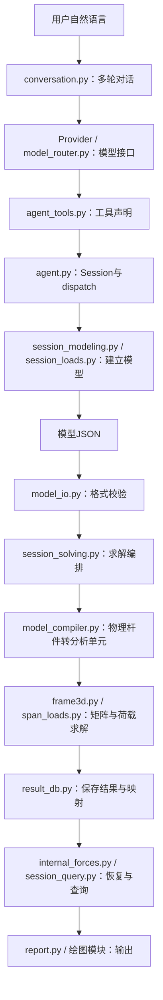

# 核心与Agent文件拆解

核查日期：2026-10-12，对象为当时的主工作区（本地 agent开发）源码、模块导入和Session调用关系；2026-10-16 随两份代码合并移入公开仓库，文中文件数、行数与模块清单为当日快照，之后新增的 features、section_solver、taper 等模块未列入。以下为职责分类，不表示已经调整目录或实现插件隔离。

src共71个顶层Python文件、29,555行，含注释、空行和工具接口声明，不包含desktop、tests及tools。这里同时存放求解内核、编辑逻辑、LLM对话、图片审核和扩展接口，因此不能把整个src当成有限元算法本体。

## 主流程先看这条链

这是职责示意，工具Schema实际作为请求参数提供给模型。默认线性路径在Session.validation_errors之后编译并求解；非线性和其他分析有各自分支。

桌面手工操作也直接调用Session方法，可以跳过对话与模型API。Session因此同时是桌面、脚本和Agent共用的应用服务层。LLM负责选择工具和组织参数；位移、内力、反力由确定性代码产生。

## 九组规模

|职责组|文件数|行数|主要意义|
|---|---:|---:|---|
|模型与手工编辑|10|2,924|模型契约、单位、截面与未完成的手工编辑状态|
|参数化生成与模型修改|6|1,735|参数转拓扑、关联清理、修改预演与历史|
|梁有限元与数值分析|10|4,276|梁矩阵、荷载、内力恢复及各类分析|
|Agent对话与统一工具会话|12|8,034|模型API、对话、共用Session和工具接口|
|图片识别与人工审核|13|4,843|图片转候选模型、人工审核到正式提交|
|结果组织、报告与绘图|9|2,985|统一结果、后处理与输出|
|局部实体与Abaqus接口|5|2,324|局部三维实体和外部求解器|
|截面优化|1|426|候选截面的实际求解与筛选|
|运行支持与外部接口|5|2,008|复现、有效性检测、取消、编码与MCP|
|合计|71|29,555|职责分类覆盖全部src顶层Python文件，无重复|

## 模型与手工编辑

|文件|行数|实际职责|
|---|---:|---|
|[model_io.py](<C:/Users/86318/Desktop/agent开发/src/model_io.py>)|609|定义JSON模型格式，迁移旧版本、校验输入并转换为Frame；也提供原子文件写入。|
|[model_compiler.py](<C:/Users/86318/Desktop/agent开发/src/model_compiler.py>)|344|将用户杆件编译成分析单元；在杆内集中荷载和显式内节点处剖分，保存物理杆件与单元映射。|
|[model_tables.py](<C:/Users/86318/Desktop/agent开发/src/model_tables.py>)|418|模型JSON和平铺表格/CSV互转，支撑表格编辑与导入导出。|
|[units.py](<C:/Users/86318/Desktop/agent开发/src/units.py>)|276|集中定义单位制、显示换算和模型单位转换。|
|[sections.py](<C:/Users/86318/Desktop/agent开发/src/sections.py>)|161|根据矩形、工字形、圆管等尺寸计算截面特性。|
|[steps.py](<C:/Users/86318/Desktop/agent开发/src/steps.py>)|241|定义分析步及荷载、边界的继承和失活，解析各步有效输入。|
|[coordinates.py](<C:/Users/86318/Desktop/agent开发/src/coordinates.py>)|49|按原始坐标定位杆件上的点，供荷载输入和结果查询共用。|
|[workplane.py](<C:/Users/86318/Desktop/agent开发/src/workplane.py>)|185|将三维视口射线投影到工作平面，处理节点和网格吸附。|
|[draft.py](<C:/Users/86318/Desktop/agent开发/src/draft.py>)|408|手工建模的宽松草稿，允许尚无支座或属性的中间状态，并提供编辑诊断。|
|[drawing.py](<C:/Users/86318/Desktop/agent开发/src/drawing.py>)|233|手工画图状态机：放点、连杆、设置支座、删除以及点击级撤销。|

## 参数化生成与模型修改

|文件|行数|实际职责|
|---|---:|---|
|[generator.py](<C:/Users/86318/Desktop/agent开发/src/generator.py>)|366|将跨、层、开间等参数展开成正交框架或门式框架的节点与杆件。|
|[bent.py](<C:/Users/86318/Desktop/agent开发/src/bent.py>)|523|生成任意折线屋面的一榀刚架，纵向复制，并提供选杆、加支撑、抬节点和换截面等算子。|
|[changes.py](<C:/Users/86318/Desktop/agent开发/src/changes.py>)|200|模型修改后的关联清理与结果失效规则，避免删除杆件后残留荷载或集合引用。|
|[change_preview.py](<C:/Users/86318/Desktop/agent开发/src/change_preview.py>)|89|计算模型内容指纹和紧凑变更摘要，支持修改预演及提交核对。|
|[history.py](<C:/Users/86318/Desktop/agent开发/src/history.py>)|353|记录建模步骤、模型快照和规模变化，支持撤销、重做与过程展示。|
|[numbering.py](<C:/Users/86318/Desktop/agent开发/src/numbering.py>)|204|节点重编号、RCM排序及矩阵带宽/profile统计，供编号校核和教学对照。|

## 梁有限元与数值分析

|文件|行数|实际职责|
|---|---:|---|
|[frame3d.py](<C:/Users/86318/Desktop/agent开发/src/frame3d.py>)|1,270|空间梁数据类型、局部刚度、坐标变换、杆端释放、刚臂、整体装配与线性稀疏求解。|
|[span_loads.py](<C:/Users/86318/Desktop/agent开发/src/span_loads.py>)|465|计算均布、区间、梯形和杆内集中力/力偶的等效端荷载及合力合矩。|
|[internal_forces.py](<C:/Users/86318/Desktop/agent开发/src/internal_forces.py>)|460|由求解结果恢复沿杆内力和杆内位移，处理集中作用位置及物理杆件剖分映射。|
|[stress.py](<C:/Users/86318/Desktop/agent开发/src/stress.py>)|208|根据梁截面及内力计算正应力，并提供剪应力、主应力和等效应力函数。|
|[strength.py](<C:/Users/86318/Desktop/agent开发/src/strength.py>)|583|逐杆应力与稳定校核，处理有效长度和适用条件，输出通过、超限或不确定。|
|[nonlinear.py](<C:/Users/86318/Desktop/agent开发/src/nonlinear.py>)|395|P-Δ二阶分析、增量分析及当前轴向双线性材料非线性。|
|[modal.py](<C:/Users/86318/Desktop/agent开发/src/modal.py>)|279|质量矩阵、自振频率与振型，以及杆内振型位移恢复。|
|[buckling.py](<C:/Users/86318/Desktop/agent开发/src/buckling.py>)|171|几何刚度矩阵、临界荷载因子与线性屈曲模态。|
|[spectrum.py](<C:/Users/86318/Desktop/agent开发/src/spectrum.py>)|209|谱函数与振型分解反应谱计算，基于模态分析扩展动力结果。|
|[skyline.py](<C:/Users/86318/Desktop/agent开发/src/skyline.py>)|236|一维变带宽矩阵存储和配套求解，作为教学与算法对照路径。|

## Agent对话与统一工具会话

|文件|行数|实际职责|
|---|---:|---|
|[agent.py](<C:/Users/86318/Desktop/agent开发/src/agent.py>)|1,031|组装Session，持有模型与结果，处理工具分派、修改确认、撤销、结果失效；也包含提示词、提供商接口与单轮循环。|
|[agent_tools.py](<C:/Users/86318/Desktop/agent开发/src/agent_tools.py>)|1,764|63个工具的名称、参数JSON Schema和说明；是接口声明，不是数值求解实现。|
|[session_base.py](<C:/Users/86318/Desktop/agent开发/src/session_base.py>)|100|ToolResult以及工具调用记录等公共基础逻辑，统一工具返回和历史行为。|
|[session_modeling.py](<C:/Users/86318/Desktop/agent开发/src/session_modeling.py>)|1,445|材料截面、参数化生成、节点杆件编辑、集合与属性指派等工具方法。|
|[session_loads.py](<C:/Users/86318/Desktop/agent开发/src/session_loads.py>)|1,179|定义工况、组合、节点与杆件荷载、强制位移、初应变和自重等工具方法。|
|[session_solving.py](<C:/Users/86318/Desktop/agent开发/src/session_solving.py>)|589|检查输入、编译模型、选择求解器、保存结果和质量检查；还编排分析步、Abaqus和局部实体分析。|
|[session_query.py](<C:/Users/86318/Desktop/agent开发/src/session_query.py>)|417|查询位移、内力、反力、出图、扫参和包络等工具方法。|
|[session_checks.py](<C:/Users/86318/Desktop/agent开发/src/session_checks.py>)|583|将强度、对称性、模态、屈曲、编号和支座诊断包装成工具返回。|
|[conversation.py](<C:/Users/86318/Desktop/agent开发/src/conversation.py>)|494|维护多轮消息与同一个Session，裁剪上下文、执行工具循环，并处理部分本地快捷查询。|
|[model_router.py](<C:/Users/86318/Desktop/agent开发/src/model_router.py>)|238|按配置选择LLM提供商，处理失败切换并记录调用情况。|
|[credentials.py](<C:/Users/86318/Desktop/agent开发/src/credentials.py>)|81|从环境变量或本地文件读取API密钥，并提供不可还原的状态指纹。|
|[workflow.py](<C:/Users/86318/Desktop/agent开发/src/workflow.py>)|113|根据模型和结果状态推导工作阶段，生成可供对话和界面使用的阶段信息。|

## 图片识别与人工审核

|文件|行数|实际职责|
|---|---:|---|
|[image_preprocess.py](<C:/Users/86318/Desktop/agent开发/src/image_preprocess.py>)|178|图片方向、裁剪等预处理，以及图片坐标到工作平面的映射。|
|[sketch_parser.py](<C:/Users/86318/Desktop/agent开发/src/sketch_parser.py>)|949|调用视觉模型解析结构草图，生成识别结果或v2识别草稿。|
|[recognition_draft.py](<C:/Users/86318/Desktop/agent开发/src/recognition_draft.py>)|579|将识别输出保存为可人工审核的草稿，管理修正、问题与版本迁移。|
|[multimodal_workflow.py](<C:/Users/86318/Desktop/agent开发/src/multimodal_workflow.py>)|659|识别流程状态、v2实体准备、草稿校验、修订指纹与提交条件。|
|[multimodal_contract.py](<C:/Users/86318/Desktop/agent开发/src/multimodal_contract.py>)|226|识别数据的确定性匹配、摘要、清单校验和评测契约；也被实际草稿流程调用。|
|[multimodal_response_cache.py](<C:/Users/86318/Desktop/agent开发/src/multimodal_response_cache.py>)|54|显式离线保存和回放视觉模型响应，供可复现识别验证。|
|[sketch_topology.py](<C:/Users/86318/Desktop/agent开发/src/sketch_topology.py>)|426|判断二维相交、相交是否连接，以及增删节点杆件和生成几何。|
|[dimension_constraints.py](<C:/Users/86318/Desktop/agent开发/src/dimension_constraints.py>)|224|利用尺寸标注和人工标定确定比例尺，应用尺寸约束。|
|[sketch_axis_refinement.py](<C:/Users/86318/Desktop/agent开发/src/sketch_axis_refinement.py>)|531|根据梁带、杆线和节点图像提出梁轴或连接位置候选，供审核。|
|[sketch_moment_refinement.py](<C:/Users/86318/Desktop/agent开发/src/sketch_moment_refinement.py>)|103|从局部彩色圆弧提出力矩中心候选，符号意义仍需审核。|
|[sketch_action_review.py](<C:/Users/86318/Desktop/agent开发/src/sketch_action_review.py>)|231|对集中作用点做视觉复核，提出拓扑候选，不生成工程结果数值。|
|[sketch_load_edit.py](<C:/Users/86318/Desktop/agent开发/src/sketch_load_edit.py>)|238|人工修改识别荷载名称与区间分布荷载，并校验作用范围几何。|
|[draft_commit.py](<C:/Users/86318/Desktop/agent开发/src/draft_commit.py>)|445|将审核后的识别草稿预演、合并并原子提交到正式模型，保存审计侧车。|

## 结果组织、报告与绘图

|文件|行数|实际职责|
|---|---:|---|
|[result_db.py](<C:/Users/86318/Desktop/agent开发/src/result_db.py>)|216|组织分析步、结果帧和场输出，保留物理杆件与分析单元对应关系，提供统一结果视图。|
|[envelope.py](<C:/Users/86318/Desktop/agent开发/src/envelope.py>)|163|沿杆逐点计算多工况/组合上下包络，并记录控制组合。|
|[symmetry.py](<C:/Users/86318/Desktop/agent开发/src/symmetry.py>)|327|识别结构对称平面并核对响应对称性，属于结果自洽检查。|
|[report.py](<C:/Users/86318/Desktop/agent开发/src/report.py>)|769|从已有有效求解结果收集图表和说明，导出Markdown/Word报告。|
|[csv_export.py](<C:/Users/86318/Desktop/agent开发/src/csv_export.py>)|74|将模型和已有结果写入单文件CSV，不触发新的求解。|
|[plot3d.py](<C:/Users/86318/Desktop/agent开发/src/plot3d.py>)|607|Matplotlib静态变形、轴力和内力图，供报告和离线输出使用。|
|[plot3d_interactive.py](<C:/Users/86318/Desktop/agent开发/src/plot3d_interactive.py>)|480|Plotly交互式三维模型、变形和内力图，主要服务网页显示路径。|
|[viz_theme.py](<C:/Users/86318/Desktop/agent开发/src/viz_theme.py>)|126|静态/交互绘图的配色和显示缩放规则。|
|[viz_symbols.py](<C:/Users/86318/Desktop/agent开发/src/viz_symbols.py>)|223|Plotly支座、节点荷载和分布荷载符号，以及荷载箭头采样。|

## 局部实体与Abaqus接口

|文件|行数|实际职责|
|---|---:|---|
|[solid3d.py](<C:/Users/86318/Desktop/agent开发/src/solid3d.py>)|304|自研小变形三维线弹性C3D10实体内核：形函数、刚度、装配、求解、应力恢复与六分量节点力映射。|
|[native_joint.py](<C:/Users/86318/Desktop/agent开发/src/native_joint.py>)|521|用Gmsh生成节点局部实体网格，再调用solid3d求解，采样表面并诊断热点收敛。|
|[solid_joint.py](<C:/Users/86318/Desktop/agent开发/src/solid_joint.py>)|932|从整体梁提取局部节点子模型，生成Abaqus实体分析流程及收敛诊断；部分规格和诊断也供自研路径复用。|
|[inp_writer.py](<C:/Users/86318/Desktop/agent开发/src/inp_writer.py>)|177|将整体梁模型写成Abaqus输入文件，供后端求解与对标。|
|[abaqus_backend.py](<C:/Users/86318/Desktop/agent开发/src/abaqus_backend.py>)|390|发现并启动Abaqus、检查作业日志、提取ODB结果并整理为统一格式。|

## 截面优化

|文件|行数|实际职责|
|---|---:|---|
|[section_optimizer.py](<C:/Users/86318/Desktop/agent开发/src/section_optimizer.py>)|426|遍历或随机采样截面尺寸，对每个候选实际调用Session求解和校核，筛选约束并生成多目标Pareto结果。|

## 运行支持与外部接口

|文件|行数|实际职责|
|---|---:|---|
|[mcp_server.py](<C:/Users/86318/Desktop/agent开发/src/mcp_server.py>)|641|把确定性求解、查询和诊断工具开放给外部MCP客户端；不会替代本项目的LLM对话循环。|
|[capsule.py](<C:/Users/86318/Desktop/agent开发/src/capsule.py>)|490|保存模型、结果摘要、环境信息和哈希，支持复现、比较及命令行查看。|
|[silent_failures.py](<C:/Users/86318/Desktop/agent开发/src/silent_failures.py>)|808|检测无荷载、近奇异、荷载不传递等可疑结果，避免把有数字等同于有效计算。|
|[task_control.py](<C:/Users/86318/Desktop/agent开发/src/task_control.py>)|31|在增量、优化样本和网格阶段之间检查取消请求，安全停止协作任务。|
|[console.py](<C:/Users/86318/Desktop/agent开发/src/console.py>)|38|处理Windows控制台UTF-8输出，避免打印中文或符号导致异常。|

## 为什么文件和代码这么多

1. 有限元基础和分析扩展放在一起：静力刚度、模态、屈曲、反应谱和实体求解是不同算法，不是一个功能的重复实现。
2. 工程输入不仅是节点和杆件，还包含工况、组合、杆内集中作用、区间荷载、释放、刚臂和单位。正确地编译输入并映射结果需要独立逻辑。
3. 工具声明占较大篇幅：agent_tools.py有1,764行，主要是63个工具的JSON Schema和说明，不代表有1,764行Agent决策算法。
4. 图片识别已经是一套独立流程：候选拓扑、尺寸比例、荷载位置、人工修改和原子提交需要跨模块协作；不能把图片输出直接送给求解器。
5. Session不仅服务LLM，还服务界面。拆成五个mixin模块主要是按职责拆文件，没有因此增加五套求解器。
6. 同时保留静态图、Plotly网页图和desktop中的VTK桌面显示，承担多种输出维护成本；它们会显示相同结果，但用途和技术栈不同。

## 哪些地方可以考虑精简

|方向|涉及文件|判断与前提|
|---|---|---|
|分离真正的LLM层与共用应用服务|agent、session_*、conversation、model_router|agent.py同时持有Session、提供商接口和单轮循环；可重组职责，但不能删掉界面也在使用的Session。|
|按能力提供工具清单|agent_tools、session_*|先确定常用工具与扩展工具，再按任务提供Schema；需测试工具选择正确性，不能只减少名称数量。|
|将图片识别作为可选能力|图片识别与人工审核组|一整组可作为模块化边界；dimension_constraints与draft_commit等为实际流程所需，不能仅按名称认为是评测附件。|
|将实体和Abaqus分析作为可选能力|solid3d、native_joint、solid_joint、inp_writer、abaqus_backend|两个后端有共享规格与诊断，需先厘清依赖；是否拆出取决于用户是否日常使用。|
|缩减网页显示的维护范围|plot3d_interactive、viz_symbols及根目录gui_app.py|如果专注桌面端，可冻结或独立维护网页入口；桌面安装包当前已排除Plotly和Streamlit，减少这部分代码不会直接省掉对应安装包体积。|
|隔离教学和实验入口|skyline、numbering、mcp_server、multimodal_response_cache、capsule|候选方向，不是可立即删除清单。numbering及capsule等已有工具或流程调用，必须核对引用并保留所需行为。|
|统一重复的小接口|agent.Provider、model_router.Provider|两处都定义complete协议，可考虑共用；收益是减少接口维护，体积收益很小。|

model_compiler、result_db、changes和silent_failures看起来属于辅助模块，却分别防止杆件映射错误、结果来源混淆、残留引用与无效计算。这些应优先保留其行为。静态阅读尚未证明任何一份文件整体无人使用，也没有给出冗余代码比例。

## 建议阅读顺序

先读generator.py看参数怎样变成节点杆件；再读model_io.py与model_compiler.py看工程模型怎样进入求解器；接着看frame3d.py的local_stiffness、assemble与solve，以及internal_forces.py的恢复方法。理解这条数值链后，再看agent.py的Session/dispatch、五个session_*域、agent_tools.py和conversation.py。

若只想理解默认静力主流程，可暂缓阅读图片审核、实体、反应谱、截面优化和MCP。但“阅读时暂缓”不等于“当前软件可以直接删除”。

本轮产物是结构说明；没有移动源码、改接口、删除功能或执行新的力学求解。
